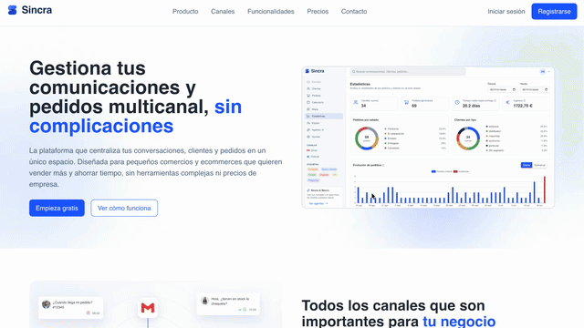

<div align="center">

### Sincra

Order and client management platform for small businesses: client records with a geographic map, orders, calendar follow-ups, statistics, team management, and **Sincra**/**Sincro** — a pair of AI agents, orchestrated by **Cleo**, that read a business's Gmail/Outlook and detect clients and orders automatically.

🔗 [Live app](https://sincra-saas.vercel.app) · Backend: `https://sincra-backend.onrender.com`

> **Note**: the backend is hosted on Render's free tier, which spins down after 15 minutes of inactivity. The first request after some idle time may take 30-60 seconds to respond.


<br>


<br>


<br>


</div>

## Preview

### 🖥️ Desktop



## What it solves

This is an MVP: it helps a small business manage its **clients and orders** in one place. A client directory with a geographic map, orders tracked from creation to delivery, calendar follow-ups and a statistics dashboard cover the manual side of that.

The distinctive piece is a pair of AI agents that do this automatically for anything that arrives by email, orchestrated by a third:

- **Sincra** reads a business's unread Gmail and Outlook messages (read-only, OAuth) and classifies each one — quote request, confirmed order, potential order, inquiry, order change/cancellation, incident, or spam — with a confidence score. Missing data (e.g. no price mentioned) is left empty rather than invented.
- **Sincro** takes what Sincra found and writes it directly to the shared database: it reuses an existing client when it recognizes one (even inferring "recurring" from context like "last week's order", not just an exact match) or creates a new one, creates the order, and attaches a note — everything marked **"Sugerido por IA"**.
- **Cleo** orchestrates the two: manages the daily reading schedule, mediates between them, and raises edge cases to a human instead of guessing.

Nothing is applied blindly: below a confidence threshold, a finding is kept as pending instead of triggering an automatic client/order creation. See [AI agents](#ai-agents--sincra-sincro--cleo) below for the full picture, including what runs where.

## Core features

### Authentication & onboarding

- Registration + login (email/password, Google and Microsoft OAuth), protected routes, role-based access (admin/employee)
- Multi-business account support with a switcher
- Password recovery via email, hardened auth (rate limiting, `helmet`, bcrypt cost 12, short-lived single-use reset tokens)
- Business registration wizard (business details → channel preferences → done)

### Clients

- Paginated list with search, channel/tag filters and KPIs
- Detail panel: summary, order history, notes, tags
- Create/edit, single and bulk delete with confirmation
- Address geocoding on save (Nominatim/OpenStreetMap), or pick an exact point from the map

### Orders

- Paginated list with search, status/channel/date filters and KPIs
- Detail panel: products, delivery timeline, notes, tags
- Create/edit with live client search; reversible "cancel" vs. real "delete" (for mistakes)
- Delivery timeline lets you jump back to any earlier status, including undoing a mistaken "Delivered"/"Cancelled"
- Incident tracking: mark an order as having an incident with a required note, resolve it with a resolution note, full history kept visible afterwards

### Map

- Clients and orders on an OpenStreetMap map (Leaflet) with clustering
- Binary layer toggle (clients / orders), KPIs and "Revenue by zone"/"Average ticket by zone" charts (ECharts) on the orders layer
- Create a client or order by clicking an empty point on the map

### Calendar

- Month/week/day views (FullCalendar), combining manual follow-ups with orders' expected delivery dates
- Create/edit/delete manual events, including multi-day ranges shown as a continuous bar
- Drag-and-drop rescheduling with optimistic UI, a confirmation toast with undo, and automatic revert on failure

### Statistics

- One dashboard, one date-range filter: KPIs (new clients, orders generated, average time to delivery, revenue), orders by status, orders evolution (daily/weekly), clients by type, revenue/ticket by channel, and a summary of what Sincra/Sincro have detected
- Info tooltips clarifying exactly what each number counts (e.g. revenue only counts delivered orders)

### Team & settings

- Admin invites a teammate by email; invitee sets their password and joins with the employee role
- Profile: personal info, password change, avatar upload (Cloudinary)
- Business settings: contact info, locale, connected channels (Gmail/Outlook), danger zone

## AI agents — Sincra, Sincro & Cleo

This is the part that doesn't look like a typical CRUD app. The agents don't run as Node.js code in this repository — they run as scheduled agents on **Grok Bot**, connected to Gmail and Outlook through its own OAuth connector (read-only, user confirms every connection). **Sincro writes directly to the shared Supabase Postgres database**, bypassing this Express API entirely — the backend and the React app simply read whatever ends up in the `Client`/`Order`/`Note`/`Tag` tables, exactly as they would for data entered by hand.

**Sincra** runs once a day (~8:00 Europe/Madrid), reads only unread messages that arrived since its last run, never marks them read and never replies. It filters obvious spam itself before anything reaches Sincro, and classifies each remaining email into one of eight types (`ExtractionType` in the schema: quote request, confirmed order, potential order, inquiry, order change, order cancellation, incident, other) with a 0–100 confidence score. Below confidence 70, a finding is still handed off but stays pending instead of triggering an automatic creation.

**Sincro** takes each finding and decides: reuse an existing client (it infers "recurring" from context, e.g. a reference to a previous order, not only an exact identifier match), or create a new one; create the order without inventing a missing price; attach a note; manage tags with a reversible soft-removal instead of a hard delete. Every record it creates is marked **"Sugerido por IA"**.

**Cleo** is the orchestrator between them — it manages the daily schedule, relays Sincra's findings to Sincro, and surfaces ambiguous cases (e.g. "is this client new or recurring?") for a human decision instead of guessing silently.

## Tech stack

| Category           | Technology                                                                              |
| ------------------ | ----------------------------------------------------------------------------------------- |
| Frontend framework | [React 19](https://react.dev/)                                                          |
| Language           | [TypeScript](https://www.typescriptlang.org/)                                           |
| Bundler            | [Vite](https://vitejs.dev/)                                                             |
| Styling            | [Tailwind CSS v4](https://tailwindcss.com/)                                             |
| UI components      | [Mantine](https://mantine.dev/) (modals, notifications)                                 |
| Forms              | [React Hook Form](https://react-hook-form.com/)                                         |
| Routing            | [React Router](https://reactrouter.com/)                                                |
| Remote state       | [TanStack Query](https://tanstack.com/query)                                            |
| Global state        | [Zustand](https://github.com/pmndrs/zustand)                                            |
| Map                | [Leaflet](https://leafletjs.com/) / [React Leaflet](https://react-leaflet.js.org/)      |
| Charts             | [ECharts](https://echarts.apache.org/) (`echarts-for-react`)                            |
| Calendar           | [FullCalendar](https://fullcalendar.io/) (`daygrid`/`timegrid`/`interaction`)            |
| Backend framework  | [Express](https://expressjs.com/)                                                       |
| ORM                | [Prisma](https://www.prisma.io/)                                                        |
| Database           | [PostgreSQL](https://www.postgresql.org/) (hosted on [Supabase](https://supabase.com/)) |
| Authentication     | Custom backend — JWT in httpOnly cookie + bcrypt, Google/Microsoft OAuth for login       |
| Real email         | Gmail API and Microsoft Graph (OAuth)                                                   |
| Image uploads      | [Cloudinary](https://cloudinary.com/) (profile avatars)                                 |
| Transactional email | [Resend](https://resend.com/) (password reset, team invitations)                       |
| Geocoding          | [Nominatim](https://nominatim.org/) (OpenStreetMap) — free, no signup                   |
| AI agent runtime   | [Grok Bot](https://x.ai/) — Sincra, Sincro and Cleo run here, not in this repo's backend |
| Testing            | [Vitest](https://vitest.dev/) + Testing Library + Supertest                             |
| Version control    | Git + GitHub (GitFlow)                                                                  |

## Getting started

### Prerequisites

- Node.js >= 20
- npm >= 9
- A PostgreSQL database (recommended: [Supabase](https://supabase.com/), free tier)
- OAuth credentials from Google Cloud Console and Azure App Registration (for login, and for connecting Gmail/Outlook)
- A [Resend](https://resend.com/) API key (password-reset and team-invitation emails)
- A [Cloudinary](https://cloudinary.com/) account (profile avatar uploads)

### Environment variables

See `.env.example` in both `backend/` and `frontend/` for the full list. Here's where to get each credential:

- **`DATABASE_URL` / `DIRECT_URL`** — Supabase dashboard → your project → "Connect" button → ORM tab → Prisma. Copy both the pooled (port 6543) and direct (port 5432) connection strings.
- **`JWT_SECRET`** — any long random string, e.g. generated with `openssl rand -base64 32`.
- **`FRONTEND_URL`** — the deployed frontend origin (e.g. `https://sincra-saas.vercel.app`); used for CORS, cookie settings, and building links in emails (password reset, team invites).
- **`GOOGLE_CLIENT_ID` / `GOOGLE_CLIENT_SECRET`** (backend) / **`VITE_GOOGLE_CLIENT_ID`** (frontend) — [Google Cloud Console](https://console.cloud.google.com/) → create a project → APIs & Services → Credentials → OAuth 2.0 Client ID. Same client ID is used on both sides.
- **`MICROSOFT_CLIENT_ID` / `MICROSOFT_CLIENT_SECRET` / `MICROSOFT_TENANT_ID` / `MICROSOFT_REDIRECT_URI`** — [Azure Portal](https://portal.azure.com/) → App registrations → New registration → platform type **Web** (not SPA) → add `MICROSOFT_REDIRECT_URI` (e.g. `https://sincra-backend.onrender.com/auth/microsoft/callback`) as a redirect URI there, exactly matching.
- **`RESEND_API_KEY`** — [Resend dashboard](https://resend.com/) → API Keys. Used to send password-reset and team-invitation emails.
- **`GEOCODING_USER_AGENT`** *(optional)* — no signup or API key: addresses are geocoded with the public [Nominatim](https://nominatim.org/) service, which asks every app to identify itself. Use the app name plus a contact email, e.g. `Sincra/1.0 (contact@example.com)`. Defaults to `Sincra/1.0` if unset.
- **`CLOUDINARY_CLOUD_NAME` / `CLOUDINARY_API_KEY` / `CLOUDINARY_API_SECRET`** — [Cloudinary dashboard](https://cloudinary.com/) → Settings → Access Keys. Used for profile avatar uploads.

### 1. Clone the repository

```bash
git clone https://github.com/gemmaadev/sincra-saas.git
cd sincra-saas
```

### 2. Backend

```bash
cd backend
npm install
```

Create a `.env` file in `backend/` (see `.env.example` for the full list of variables — includes `DATABASE_URL` and `DIRECT_URL`, both required for Supabase with Prisma).

```bash
npm run dev
```

**Demo data (optional)**: set `SEED_BUSINESS_EMAIL` in `.env` to an account you've already registered, then run:

```bash
npx prisma db seed
```

This fills that account's business with example clients and orders (fake data, including a few intentional near-duplicates to demo the "possible duplicate client" detection). Safe to re-run — it replaces that business's data each time instead of piling up duplicates.

### 3. Frontend

```bash
cd frontend
npm install
```

Create a `.env` file in `frontend/` (see `.env.example`).

```bash
npm run dev
```

The app will be available at the URL shown in your terminal (typically `http://localhost:5173`).

## Testing

```bash
# Backend
cd backend
npm test

# Frontend
cd frontend
npm test
```

### Test coverage

| Category   | Frontend | Backend |
| ---------- | -------- | ------- |
| Statements | 93.74%   | 93.76%  |
| Branches   | 90.46%   | 91.35%  |
| Functions  | 90.68%   | 85.48%  |
| Lines      | 94.13%   | 94.14%  |

_Tests written following Gherkin scenarios (Given / When / Then) as comments above each test._

## Project structure

```
sincra-saas/
├── backend/
│   └── src/
│       ├── app.ts
│       ├── config/
│       ├── middleware/
│       ├── shared/
│       └── features/
│           ├── auth/
│           ├── user/
│           ├── client/
│           ├── order/
│           │   └── map/            # clients/orders map endpoint (sub-feature)
│           ├── calendar/
│           ├── stats/
│           ├── note/
│           ├── tag/
│           ├── team/
│           ├── settings/           # business settings, Gmail/Outlook connections
│           ├── extraction/         # shared format for a Sincra "finding"
│           ├── ai/                 # empty scaffold — Not MPV, agents run on Grok Bot
│           └── communication/      # empty scaffold — Not MPV, unified inbox
│
└── frontend/
    └── src/
        ├── app/
        │   ├── layout/
        │   ├── router/
        │   └── providers/
        ├── pages/
        ├── shared/
        │   ├── components/
        │   ├── hooks/
        │   ├── services/
        │   ├── store/
        │   └── utils/
        └── features/
            ├── auth/
            ├── onboarding/
            ├── profile/
            ├── landing/
            ├── clients/
            ├── orders/
            ├── calendar/
            ├── map/
            ├── stats/
            ├── automations/        # "Agentes IA" info page (Sincra/Sincro)
            ├── team/
            ├── settings/
            ├── tags/
            └── inbox/              # empty scaffold — Not MPV, unified inbox
```

## Architecture decisions

- **Feature-based architecture** on both frontend and backend — each domain owns its own components/hooks/types (frontend) or controllers/services/routes (backend)
- **Custom auth instead of an external provider** (Firebase, Auth0...) — JWT signed by the backend itself, stored in an httpOnly cookie, with bcrypt (cost factor 12) for password hashing. Session cookies are `secure`/`SameSite=None`, since frontend (Vercel) and backend (Render) are different origins in production
- **AI agents run externally on Grok Bot, writing straight to the shared database** — not through this API. Sincra/Sincro/Cleo were deliberately kept out of this Express backend: the agent runtime, scheduling and Gmail/Outlook reading loop live entirely on Grok Bot, and Sincro writes `Client`/`Order`/`Note`/`Tag` rows directly in Supabase. This app only needs to read the same tables correctly and mark `aiGenerated` records as "Sugerido por IA" — it doesn't need to know *how* those rows got there. The one exception is `applySureIncidents` in `order.service.ts`, which reads high-confidence `INCIDENT` findings from the shared `extractions` table and applies them to orders as real backend code
- **Client addresses are geocoded on save with Nominatim (OpenStreetMap)** — free and keyless. When a client is created, or its address/zone is edited without explicit coordinates, the backend looks up `address, zone` restricted to the business's country and stores the coordinates. It never blocks the save: if Nominatim is slow, down or finds nothing, the client is saved anyway and the map falls back to the zone's centroid. Orders follow the same rule for their own delivery address
- **Orders have their own cancel/delete distinction** — "Cancelar pedido" is a reversible status change; "Eliminar" is a real hard delete, reserved for orders that should never have existed. The delivery timeline lets a user click back to any earlier status to undo a mistaken "Delivered" or "Cancelled"
- **Order incidents keep their history visible after resolution** — marking an order `INCIDENT` requires a note; resolving it requires a resolution note; both stay visible in the timeline afterwards instead of disappearing once the order moves on
- **`Note` and `Tag` are shared across `Client` and `Order`**, not duplicated per entity — a note or tag assignment belongs to exactly one of the two, enforced in the service layer
- **The calendar merges two different sources into one view, not a stored join** — manual follow-ups (a real `CalendarEvent` row) and orders' own expected delivery date are combined for a given date range, with order-derived entries marked read-only
- **The stats dashboard is one API call, not one per chart** — every widget shares the same date-range filter, so the backend composes all of them (`GET /stats/dashboard`) in one response, the same pattern used by the clients/orders map endpoints
- **The date range and channel filters are synced across Map, Stats and Orders** via a small shared Zustand store, instead of each page keeping its own local state
- **Desktop-first, not mobile-first** — the app is a B2B dashboard/CRM tool, used mainly on desktop; styles are written for desktop by default and overridden for smaller screens (`max-lg:`), not the other way around

**Explicitly out of scope for this delivery** (a closed decision, not deprioritized work): the unified inbox (Gmail/Outlook/WhatsApp/Instagram/Messenger in one view), converting a conversation directly into an order, cross-channel duplicate client detection, the original classifier/suggested-reply/conversation-summary agents, real Stripe billing, and a separate internal Sincra team access system.

## Author

**Gemma Maeso** · [@gemmaadev](https://github.com/gemmaadev)

Project built as part of the **IT Academy** program by Barcelona Activa, using Claude Code and Grok Bot (as **Cleo**, orchestrating **Sincra** and **Sincro**) at different stages of the development process.
